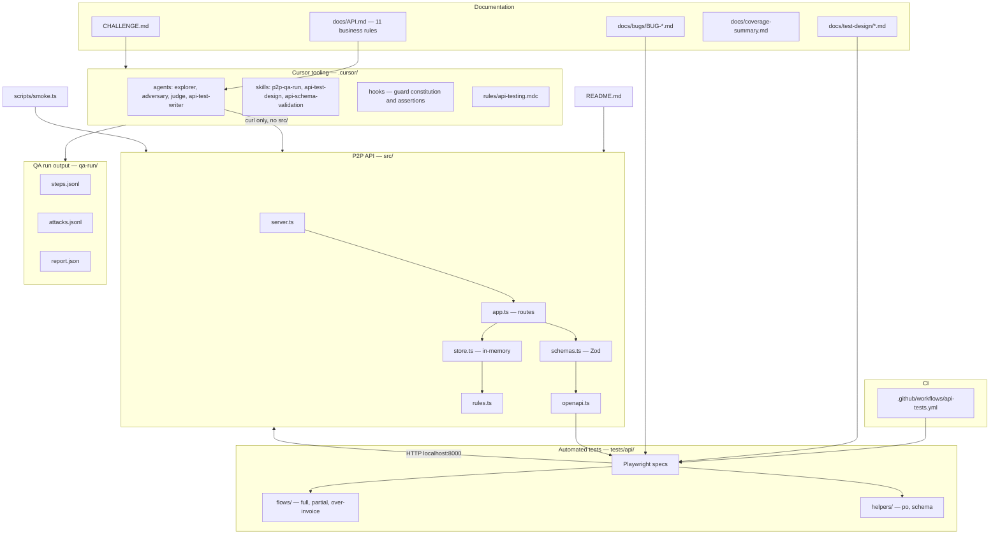
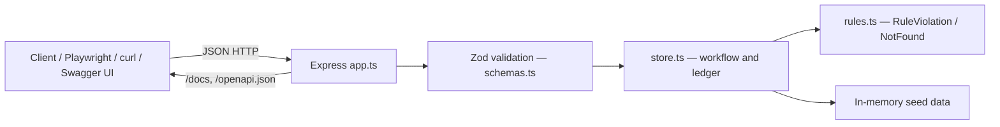
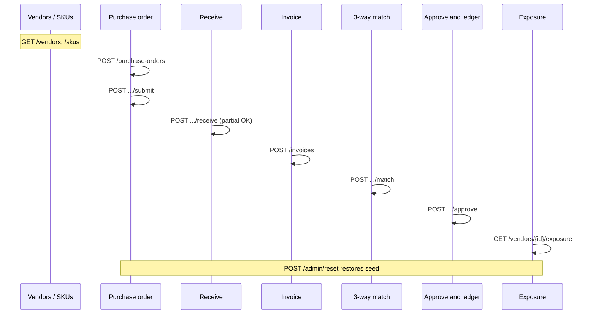
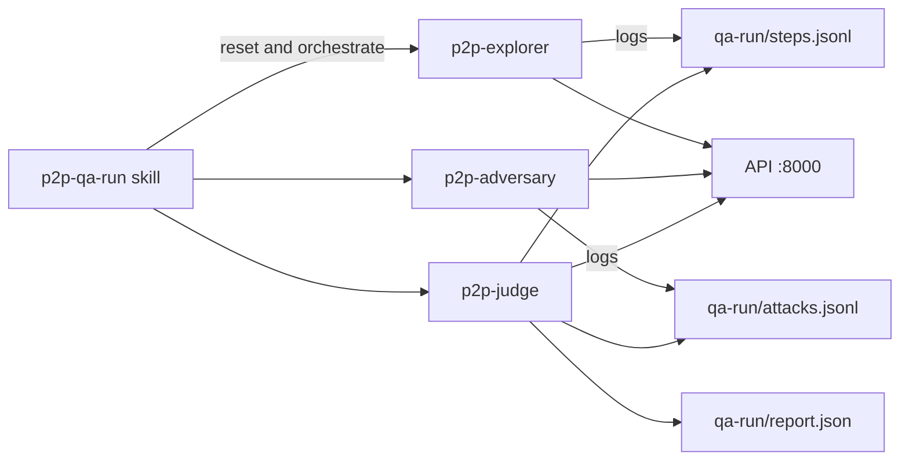

# P2P API Practicum — project diagram

This document maps how the repository fits together: the practice API, documentation, automated tests, Cursor QA agents, and CI.

**PDF export:** run `npm run docs:diagram-pdf` to regenerate [project-diagram.pdf](./project-diagram.pdf) from this file.

## Repository overview

## Runtime stack (request path)

## Purchase-to-pay happy path

## QA agent pipeline (challenge)

## How the layers relate

| Layer | Role |
| --- | --- |
| **API** | Express + Zod + in-memory store; intentional defects (find via HTTP, not by reading `src/`) |
| **Docs** | Human rules in `API.md`; machine schema via `/openapi.json` and Swagger at `/docs` |
| **Playwright** | Regression and flow tests under `tests/api/`; CI runs them on push |
| **QA agents** | Explorer, then adversary, then judge; artifacts under `qa-run/` |
| **Bug reports** | `docs/bugs/` documents findings tied to regression tests |

## Key paths

| Path | Contents |
| --- | --- |
| `src/` | API implementation |
| `docs/API.md` | Written reference and money rules |
| `docs/test-design/` | Human-approved test design tables |
| `docs/bugs/` | Bug write-ups from test findings |
| `tests/api/` | Playwright API tests |
| `.cursor/agents/` | Subagent prompts (explorer, adversary, judge, test writer) |
| `.cursor/skills/p2p-qa-run/` | Orchestrates the QA agent run |
| `qa-run/` | Output from the last QA agent run |
| `CHALLENGE.md` | 60-minute QA agent exercise spec |
